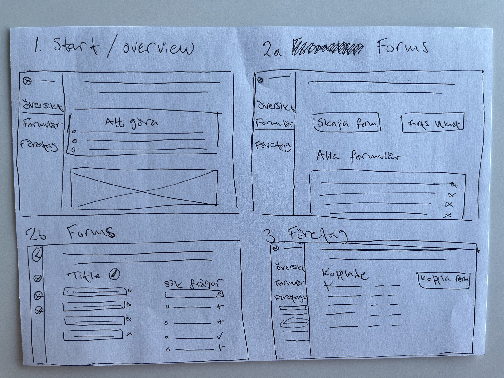
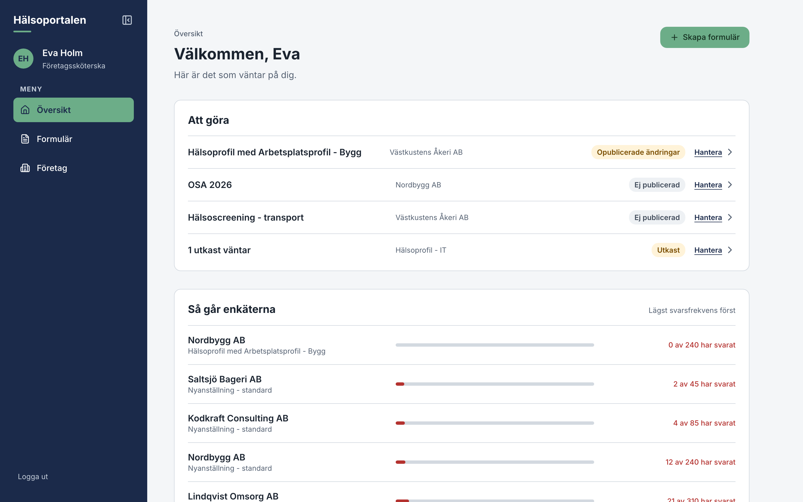
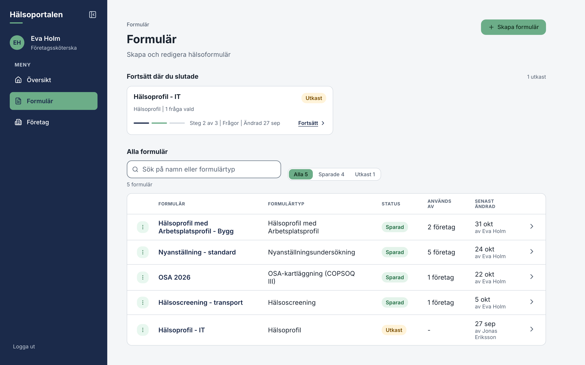
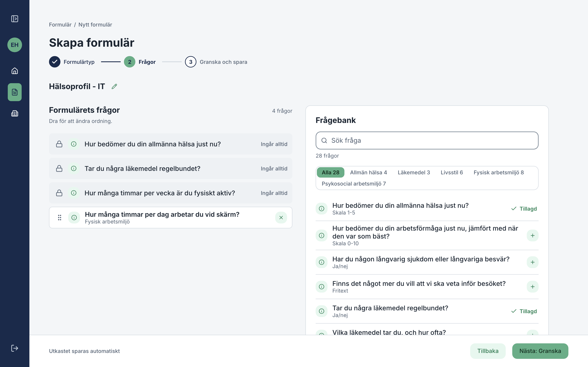
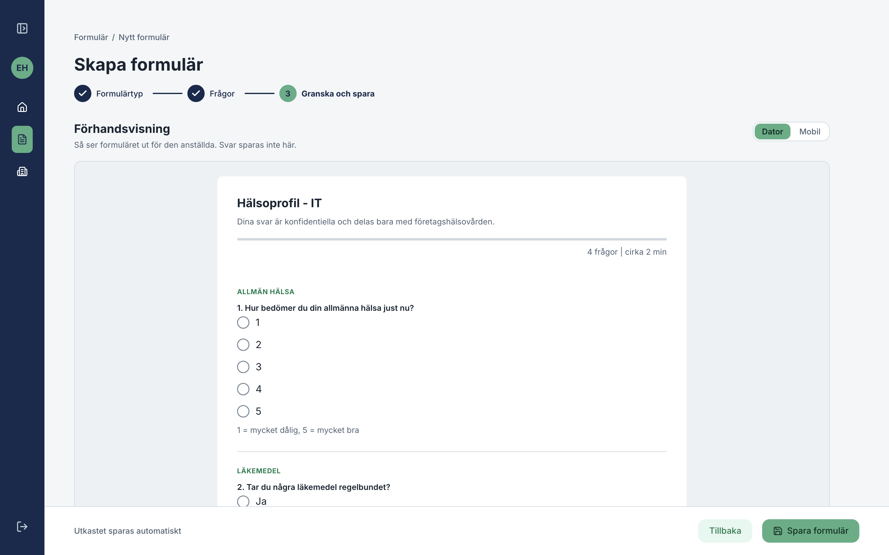
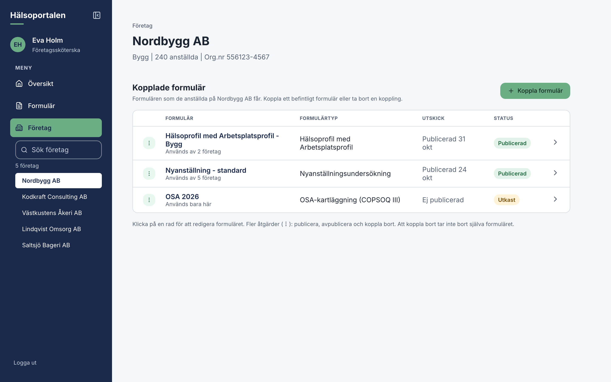

# Health form admin portal

This is a quick demo project with selected functionalities, aiming at showcasing how I work from Idea to full implementation with code.

- Frontend built with React 19, TypeScript 6, Vite 8 and React Router 8.
- Backend built with Express 4.

### Quick start

Requires Node 20.19+ (or 22.12+). From this folder:

```bash
$ npm install # installs both frontend and backend
$ npm run dev # runs both frontend and backend
```

### NOTES:

**Rest API:**

> This is a simple backend API generated by AI based on specific requirements, to provide a starting point for my work with some seed data.

The api is running on `localhost:3001`.
`Backend/README.md` has the request and response details.

| Method & path                                     | What it does                                        |
| ------------------------------------------------- | --------------------------------------------------- |
| `GET /api/me`                                     | The logged-in staff member                          |
| `GET /api/overview`                               | Översikt: to-dos and response rates                 |
| `GET /api/question-areas`                         | Question areas with question counts                 |
| `GET /api/question-bank?area=&search=`            | All bank questions, filtered by area or search text |
| `GET /api/form-types`                             | The form types and their standard questions         |
| `GET /api/forms?search=&limit=`                   | All forms, most recently changed first              |
| `POST /api/forms`                                 | Create a draft form from a form type                |
| `GET /api/forms/:id`                              | One form with its questions                         |
| `PUT /api/forms/:id`                              | Save a form (autosave)                              |
| `POST /api/forms/:id/complete`                    | "Granska och spara": save a draft, or save an edit  |
| `POST /api/forms/:id/discard-edit`                | Throw away an unsaved edit of a saved form          |
| `POST /api/forms/:id/copy`                        | Copy a form as a new draft                          |
| `DELETE /api/forms/:id`                           | Delete a form that isn't linked to a company        |
| `GET /api/companies?search=`                      | All companies                                       |
| `GET /api/companies/:id`                          | One company                                         |
| `GET /api/companies/:id/forms`                    | Forms linked to the company                         |
| `POST /api/companies/:id/forms`                   | Link a saved form to the company                    |
| `DELETE /api/companies/:id/forms/:formId`         | Unlink a form (the form itself is kept)             |
| `POST /api/companies/:id/forms/:formId/publish`   | Publish the form at the company                     |
| `POST /api/companies/:id/forms/:formId/unpublish` | Unpublish it                                        |
| `POST /api/_reset`                                | Restore the original mock data                      |

**Frontend:**

- Running on `localhost:5173`.
- `localhost:5173/library`: An overview of all UI components used in the codebase. It only runs with `npm run dev` and is left out of the production build (`npm run build`).
- `screenshots` directory will show some views of the web app.

### Methodology

1. It all started with my handdrawn wireframes on a paper:



2. Which got translated into a small Figma design: [view it in Figma](https://www.figma.com/design/fVVfp8ai9WHbdVignf5xNI/Untitled?node-id=42-72&t=rXW5sjrflm4uynxh-1)

3. Then moved to coding and started building the components library which can be viewed at `localhost:5173/library`. The idea is that any new feature, page, or functionality should reuse existing components with no or very little need for custom and new CSS.

### TODO

- Make sure components are fully responsive for different screen sizes.
- Verify the accessibility that's built in (keyboard support, focus handling, screen reader announcements, AA contrast, reduced motion) with automated checks such as axe and manual testing with VoiceOver and NVDA.
- Add testing to mostly protect against regression.
- Provide proper documentation and guardrails for agents working in this repo. This could include more linting rules to keep things under control as much as possible.
- Look into edge cases.
- Put more work into the non happy path flows.

### Screenshots

A quick look at the flow, without running the app.

**1. Översikt:** what needs attention, and how the published surveys are going.



**2. Formulär:** drafts to continue, and all forms.



**3. Skapa formulär, step 2:** pick questions from the question bank and drag them into order.



**4. Skapa formulär, step 3:** preview the form as the employee sees it, then save it.



**5. Företag:** link saved forms to a company and publish them there.


